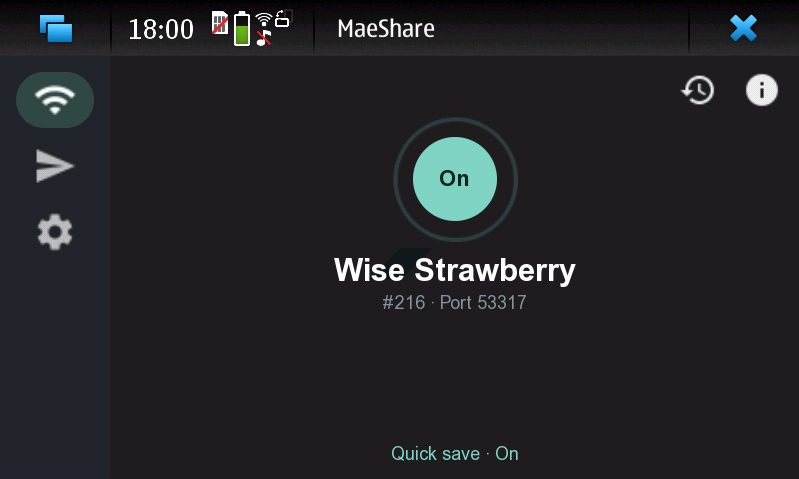
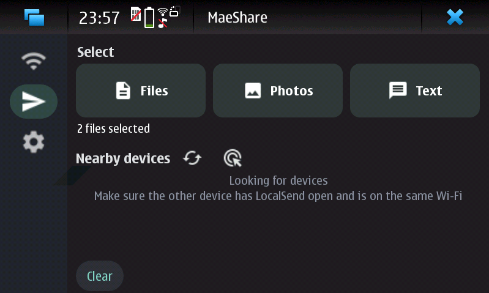
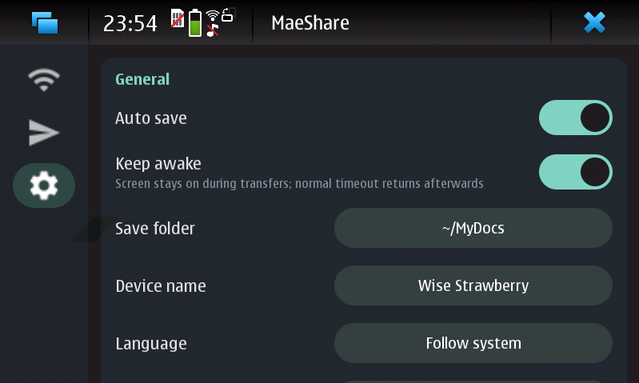
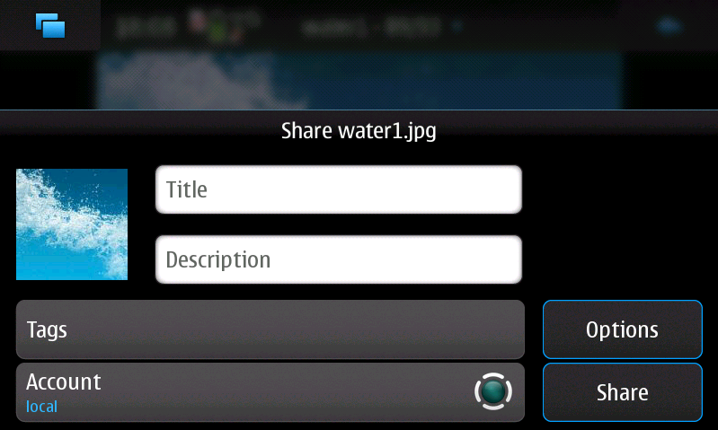
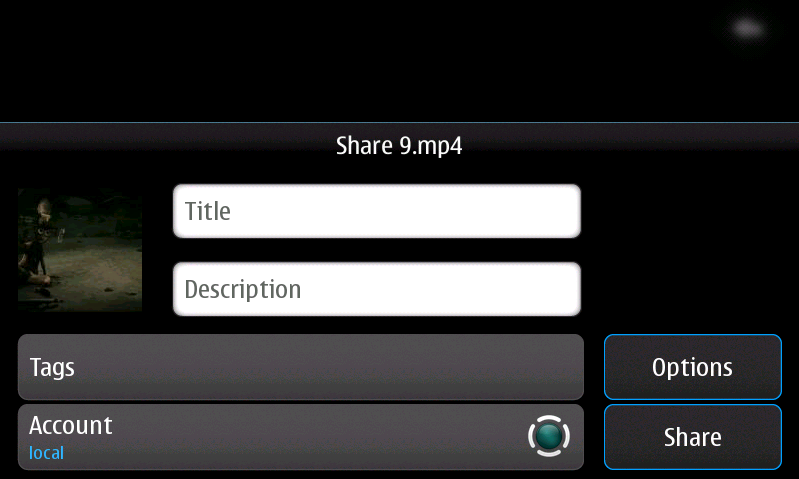

<div align="center">


# MaeShare

**A LocalSend-compatible file transfer app for the Nokia N900 — with real Maemo system integration.**

`Maemo 5 (Fremantle)` · `Nokia N900` · `Qt 4.7 / QML` · `LocalSend protocol` · `v1.0.0`

[**中文说明 →** `README.zh-CN.md`](README.zh-CN.md)

</div>

---

## What is this?

MaeShare is a native **Maemo 5 (Fremantle)** client for the [LocalSend](https://localsend.org) protocol, written for the Nokia N900. It talks to the official LocalSend apps on Windows / macOS / Linux / Android / iOS over plain HTTPS inside your LAN — no server, no account, no cloud.

It is not just a port of a desktop UI: it is built around how Maemo actually works, including the part almost nobody tries — **registering itself into the system Share menu**, so photos selected in the built-in **Photos / Image Viewer** can be handed to MaeShare with one tap.

```
Photos (multi-select)  ──[Share]──►  libsharing panel  ──►  libmaeshare.so  ──►  maeshare --share …
        ▲                     ▲                ▲                                    │
        │                     │                └ served by maeshare.service.xml     ▼
   system app          Maemo share UI          (plugin in /usr/lib/sharing/plugins)  MaeShare opens
                                                                                    its own device picker
```

---

## Screenshots

| Receive | Send | Settings |
|---|---|---|
|  |  |  |

---

## Features

- **LocalSend protocol** — same REST/HTTPS endpoints on port `53317`, so it interoperates with the official LocalSend clients.
- **Receive** — one-tap `On / Off` radar, quick-save toggle, receive history panel (`Open folder` / `Clear history`), info sheet with device name, IP and port.
- **Send** — pick content first (Files / Photos / Text), then pick the target device; multi-file selection (up to 20), text messages sent as real LocalSend text messages (shown in a dialog, not saved as a `.txt`).
- **Manual address** — the bullseye icon next to *Nearby devices* opens an address page; type the peer's IPv4 (LAN ranges `10.` / `172.16.` / `192.168.` only), the app probes it, pins its certificate fingerprint and remembers it across restarts. Useful when multicast is blocked, filtered by the router, or the peer sits on another subnet. Malformed or non-LAN addresses are rejected before anything is opened.
- **4 UI languages** — English, 简体中文, 繁體中文 (HK / TW), each following the system locale.
- **Keep awake during transfers** — uses MCE's `req_display_blanking_pause` so the screen and Wi-Fi survive a large transfer, then returns to the normal timeout. It never rewrites your lock-screen settings.
- **System Share integration** — described in detail below.

### CLI flags

| Flag | Effect |
|---|---|
| `--share <path>…` | Pre-select the given files and open the Send tab (used by the share plugin) |
| `--open <file>` | Open a received file |
| `--tab-receive / --tab-send / --tab-settings / --tab-about / …` | Start on a specific screen (handy for screenshots and debugging) |

---

## System-level Share integration (Maemo `libsharing`)

The N900's **Photos** app does not read `.desktop` MIME associations for its *Share* button. Sharing is owned by `sharing-manager` + `libsharing`, which enumerate services from XML descriptors and load a plugin `.so` per service. MaeShare registers itself through that share via service interface, so it appears as one entry in the system Share panel.

| Share panel, photo | Share panel, video |
|---|---|
|  |  |

Registering it means shipping **three artifacts**:

| Artifact | Installed to | Purpose |
|---|---|---|
| `maeshare.service.xml` | `/usr/share/sharing/services/` | Makes the "MaeShare" row appear in the Share panel; declares the accepted MIME types and multi-select support |
| `libmaeshare.so` | `/usr/lib/sharing/plugins/` | Loaded by the framework when the row is tapped; reads the selected media and launches the app |
| `sharing_maeshare.png` | `/usr/share/icons/hicolor/48x48/apps/` | Icon shown in the panel |

```xml
<service plugin="libmaeshare.so" provider="maeshare">
    <accounts type="password" realm="maeshare" plugInSetup="1" plugInEdit="1"></accounts>
    <ui>
        <name>MaeShare</name>
        <icon type="post">sharing_maeshare</icon>
        <icon type="setup">sharing_maeshare</icon>
    </ui>
    <media tags="1"><types><mime>image/jpeg</mime><mime>image/png</mime></types></media>
</service>
```

The plugin exports the seven entry points the framework looks up with `g_module_symbol`:
`sharing_plugin_interface_init` / `_uninit` / `_send` / `_account_setup` / `_account_validate` / `_edit_account` / `_update_options`.

### Four ABI details

These were established by disassembling `libsharing.so.0` and reading device logs. They are undocumented, and all four are required:

1. **`init` must return `0`.** The loader does `cmp r0,#0; beq keep` — a non-zero return takes the `g_module_close()` path and unloads the plugin immediately, so `send` is never reached and tapping the row does nothing.
2. **The account callbacks receive shifted arguments.** `sharing_plugin_account_setup` replaces `r0` with `r1` before calling the plugin and takes the 4th argument from the stack, so parameter 1 is the `SharingService*` and parameter 2 is the `SharingAccount*`. (`_send` is *not* shifted.)
3. **The plugin must provision its own account.** When the panel finds a service without an account it calls `account_setup`; the plugin has to create it (`sharing_account_store_add_account` + `sharing_account_store_set_account_param`) and return `0`. Without that, the panel stops at *"Validate account to complete account setup"* and `account_validate` must also return `0`.
4. **The media paths are temporary.** `sharing_entry_media_get_localpath()` returns `/home/user/.sharing/outbox/attachment-XXXX`, which `libsharing` deletes as soon as `send` returns. The plugin therefore copies each file into a staging directory first, and passes the copies to the app.

### Staged copies are deleted after the send

A staged copy is necessary, but it does not stay on the device:

| Step | What happens | Where |
|---|---|---|
| 1 | Plugin copies the media into `~/.maeshare-share/` — a hidden directory outside `MyDocs`, so the media indexer / gallery does not pick the copies up as new photos | `libmaeshare-plugin.c` |
| 2 | App is launched with `--share <copy>…` and records which selected files came from that staging directory | `transfer.h` |
| 3 | When the send job ends (success or cancel), the app deletes those copies and drops them from the selection, so the send page does not keep pointing at deleted files | `transfer.h` (`jobEnded` / `dropStagedCopies`) |
| 4 | If the app is killed, power is lost, or the plugin launches the app but it never comes up, the remainder is swept: the app sweeps `~/.maeshare-share` and the legacy `~/MyDocs/.maeshare-share` at every primary-instance start, and the plugin sweeps the same two directories before staging a new batch | `app.cpp` (`sweepShareStaging`), plugin (`sweep_stage_dirs`) |

The sweep uses a **7-day TTL** rather than deleting everything at boot, because a copy may still be the only artifact of a share that has not been sent yet. Files passed on the current `--share` command line are never touched.

Two further findings: the panel decides "has account" from the **signon** account list (writing GConf keys by hand does not fool it), and **usernames must be unique per service** (`account with user name X already exists`).

### Hand-off to the app

`libmaeshare.so` `fork()`s, `setsid()`s, detaches stdio and `execv`s:

```
/opt/maeshare/maeshare --share <copy1> <copy2> …
```

If an instance is already running, the new process detects it over `QLocalServer` (socket `chih-localsend-maemo-<uid>`), forwards `activate` + one `share:<abs path>` line per file, and exits — so the existing window is raised instead of duplicated.

### Packaging

The packaging step builds the plugin first, then stages all three artifacts into the `.deb`, and ships `DEBIAN/postinst` / `prerm` hooks that restart `sharing-manager` (it does not watch the services directory). Output: `maeshare_1.0.0_armel.deb`, package name `maeshare`.

---

## Build

Everything is cross-compiled for `armel` (Maemo 5) with `arm-linux-gnueabi-gcc` and a Qt 4.7 host `moc`. Full command lines, toolchain notes and packaging steps are in **[BUILD.md](BUILD.md)**.

```bash
# share plugin — libc + libdl only, no glib / no gtk / no Qt
cd src/sharing-plugin && make        # → libmaeshare.so

# client — Qt 4.7 / QML, moc'd from transfer.h + singleinstance.h
# see BUILD.md for the exact compile/link lines and install layout
```

Release layout:

```
README.md  README.zh-CN.md  LICENSE  NOTICE  RELEASE.md  BUILD.md
src/app/              Qt 4.7 / QML client: app.cpp, transfer.h, singleinstance.h, qml/
src/sharing-plugin/   Maemo libsharing plugin: sources, service XML, Makefile, icon
docs/                 logo + screenshots used by these READMEs
```

This archive is **source only**. The prebuilt `maeshare_1.0.0_armel.deb` is a separate
asset on the release page — download and install that one if you just want the app on a
device.

---

## Known limitations

- The Share panel accepts **`image/jpeg` and `image/png`** only — WebP and HEIC cannot be displayed by the device's gallery in the first place, so they are ignored on purpose.
- **iOS LocalSend 2.2 only lists MaeShare when the identity certificate uses ECDSA P-256.** During discovery the iOS client (Flutter `dart:io` on BoringSSL) drops the TLS session right after the server's `Finished` if the certificate is RSA — no alert, just a silent `EOF`. Sending to the same device by typing its IP still works, because that path pins the fingerprint instead of the announcement. Identities created on first launch are ECDSA P-256, and `announce` advertises protocol `2.1`.
- Staged share copies live in `~/.maeshare-share/` and are removed when the send finishes or is cancelled; orphans older than 7 days are swept at startup (a copy from an unfinished share is therefore kept, not deleted).
- `sharing-manager` is not D-Bus-activated on this device build, so it must be running for the Share row to work.
- Very large transfers over 802.11g can still be interrupted by Wi-Fi power saving; "Keep awake" mitigates but does not eliminate it.

---

## Credits & thanks

This project stands on other people's work — with real gratitude:

- **[LocalSend](https://localsend.org)** and its contributors — the protocol, the REST endpoints and much of the visual language. MaeShare is an independent compatible implementation, not affiliated with the LocalSend project.
- **[MeeShare / ChengChihz-MeeGo-Share](https://github.com/ChengChihz/MeeGo-Share)** (Apache-2.0) — origin of the network core (`probe`), fixed and extended here for Fremantle.
- **Qt 4.7 / QML**, **Mbed TLS**, **QJson** — the stack this app is built on.
- **Maemo 5 / Fremantle community**, CSSU, **[r/N900](https://www.reddit.com/r/N900/)** and the people who kept the SDK and package archives alive — most of the build and hardware knowledge for this device comes from them.
- **Nokia's `libsharing` / `sharing-manager`** — the framework the Share integration is built on; the ABI notes above come from it.

---

## License

The network core (`probe`) is derived from MeeShare / ChengChihz-MeeGo-Share and keeps its **Apache-2.0** notice. The Maemo UI, the `libsharing` plugin and the packaging in this repository are released under the same **Apache-2.0** terms.

Third-party components (Qt, Mbed TLS, QJson) remain under their own licenses.
