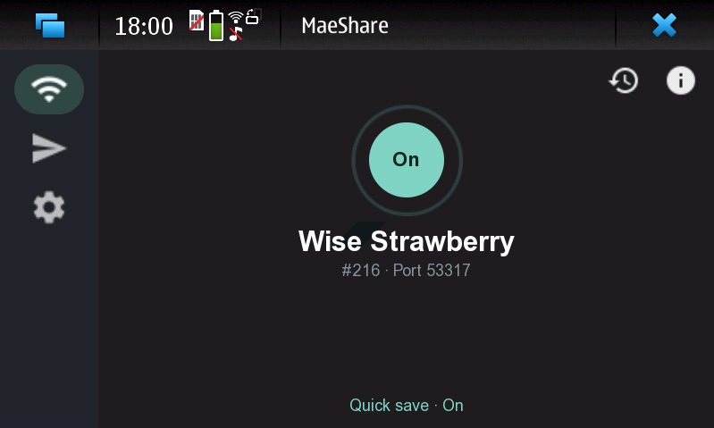
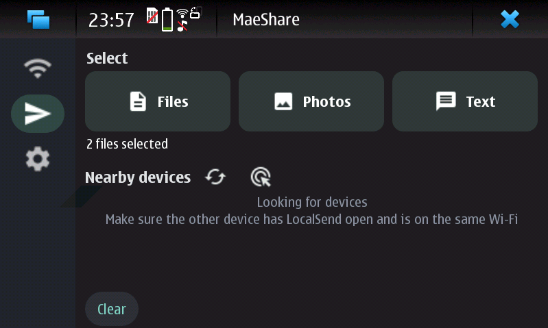
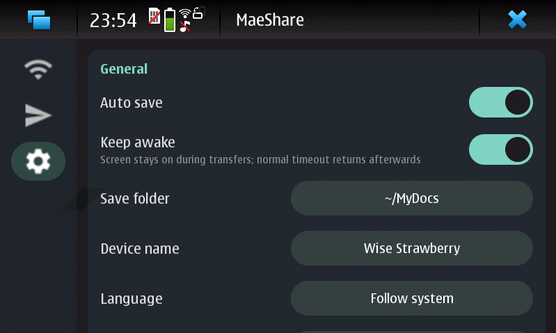
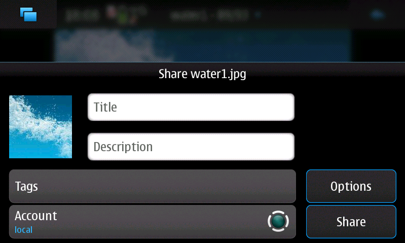
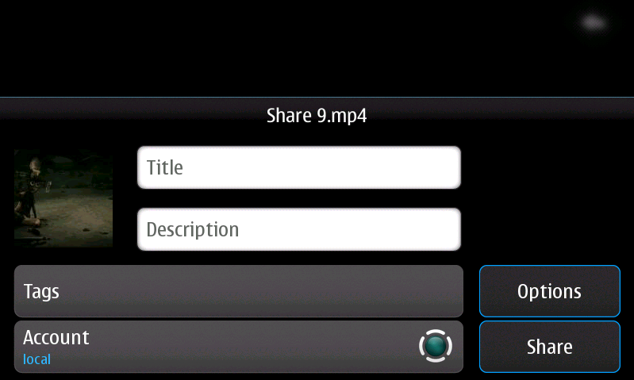

<div align="center">


# MaeShare

**一个面向诺基亚 N900 的 LocalSend 兼容传输应用 —— 带真正的 Maemo 系统集成。**

`Maemo 5 (Fremantle)` · `Nokia N900` · `Qt 4.7 / QML` · `LocalSend 协议` · `v1.0.0`

[**English README →** `README.md`](README.md)

</div>

---

## 这是什么

MaeShare 是 LocalSend 协议在 Maemo 5 上的原生实现。它通过局域网内的普通 HTTPS 与 Windows / macOS / Linux / Android / iOS 上的官方 LocalSend 互通——不需要服务器、不需要账号、不经过云端。

它不只是把桌面界面搬过来：整个应用是围绕 Maemo 的真实机制写的，包括几乎没人做的那一步——**把 MaeShare 注册进系统分享面板**，让相册里选中的照片一键交给 MaeShare。

```
系统相册（多选照片）──[Share]──►  libsharing 分享面板  ──►  libmaeshare.so  ──►  maeshare --share …
                                        ▲                                            │
                                        └ 由 maeshare.service.xml 描述的服务条目        ▼
                                                                              MaeShare 打开设备选择页
```

---

## 截图

| 接收页 | 发送页 | 设置页 |
|---|---|---|
|  |  |  |

---

## 功能

- **LocalSend 协议**：端口 `53317`，与官方客户端互通。
- **接收**：一键 `On / Off` 雷达、快速保存开关、接收历史（`Open folder` / `Clear history`）、信息浮层（设备名 / IP / 端口）。
- **发送**：先选内容（Files / Photos / Text），再选设备；多选上限 20 个；文本按 LocalSend 文本消息发送（以对话框呈现，不落成 `.txt` 文件）。
- **手输地址**：发送页「附近设备」右边的靶心图标进独立输入页；填对方局域网 IPv4（仅接受 `10.` / `172.16.` / `192.168.` 段），应用会探测该地址、固定其证书指纹，并把设备记进列表（重启仍在）。组播被路由器拦掉、跨网段、或对端不回应广播时用这个。非法或非内网地址在建立连接前就被拒掉。
- **四语言界面**：English、简体中文、繁體中文（香港 / 台灣），跟随系统。
- **传输期保持唤醒**：通过 MCE 的 `req_display_blanking_pause` 阻止中途灭屏，结束后恢复正常超时；**不会改写你的锁屏设置**。
- **系统分享集成**：见下文。

### 命令行参数

| 参数 | 作用 |
|---|---|
| `--share <path>…` | 预选指定文件并进入发送页（分享插件调用的就是它） |
| `--open <file>` | 打开已接收的文件 |
| `--tab-receive / --tab-send / --tab-settings / --tab-about / …` | 指定启动页（截图与调试用） |

---

## 系统级分享集成（Maemo `libsharing`）

N900 的相册点 Share 时**不读** `.desktop` 的 MIME 关联，而是由 `sharing-manager` + `libsharing` 从 XML 服务描述里枚举服务，再按服务加载对应的 `.so` 插件。MaeShare 就是通过这套 share via service 接口注册的，所以在系统分享面板里表现为其中一个条目。

| 分享面板（照片） | 分享面板（视频） |
|---|---|
|  |  |

注册 MaeShare 需要交付**三件套**：

| 交付件 | 安装位置 | 作用 |
|---|---|---|
| `maeshare.service.xml` | `/usr/share/sharing/services/` | 让面板出现「MaeShare」一行，并声明支持的 MIME 与多选 |
| `libmaeshare.so` | `/usr/lib/sharing/plugins/` | 面板点条目时被框架加载，取出选中媒体并拉起客户端 |
| `sharing_maeshare.png` | `/usr/share/icons/hicolor/48x48/apps/` | 面板条目图标 |

```xml
<service plugin="libmaeshare.so" provider="maeshare">
    <accounts type="password" realm="maeshare" plugInSetup="1" plugInEdit="1"></accounts>
    <ui>
        <name>MaeShare</name>
        <icon type="post">sharing_maeshare</icon>
        <icon type="setup">sharing_maeshare</icon>
    </ui>
    <media tags="1"><types><mime>image/jpeg</mime><mime>image/png</mime></types></media>
</service>
```

插件必须导出框架用 `g_module_symbol` 查找的七个入口：
`sharing_plugin_interface_init` / `_uninit` / `_send` / `_account_setup` / `_account_validate` / `_edit_account` / `_update_options`。

### 四个 ABI 细节

这些结论来自反汇编 `libsharing.so.0` 与阅读设备日志。官方没有文档，这四条都必需：

1. **`init` 必须返回 `0`**。加载器是 `cmp r0,#0; beq 保留`——返回非 0 会走 `g_module_close()` 立刻卸载插件，`send` 因此不会被调用，点击条目也没有反应。
2. **账号回调参数整体错位**。`sharing_plugin_account_setup` 调用插件前把 `r0` 换成 `r1`，第 4 个参数从栈上取，所以第 1 个参数是 `SharingService*`、第 2 个才是 `SharingAccount*`（`_send` 不错位）。
3. **账号必须由插件自己建全**。面板发现服务没有账号时会调 `account_setup`；插件要自己 `sharing_account_store_add_account` + `sharing_account_store_set_account_param` 并返回 `0`。否则面板停在 *"Validate account to complete account setup"*，而 `account_validate` 也必须返回 `0`。
4. **媒体路径是临时的**。`sharing_entry_media_get_localpath()` 给的是 `/home/user/.sharing/outbox/attachment-XXXX`，`send` 一返回 `libsharing` 就删掉。所以插件先把文件拷进一个暂存目录，再把副本路径交给客户端。

### 暂存副本在发送后删除

副本是操作必需的，但不会留在设备上：

| 步骤 | 做什么 | 位置 |
|---|---|---|
| 1 | 插件把媒体拷到 `~/.maeshare-share/`——隐藏目录，不在 `MyDocs` 里，图库 / 媒体索引不会把副本扫成新照片 | `libmaeshare-plugin.c` |
| 2 | 客户端以 `--share <副本>…` 启动，并记录哪些已选文件来自这个暂存目录 | `transfer.h` |
| 3 | 发送结束（成功或取消）时删掉这些副本，并从已选内容里摘掉，发送页不会保留已不存在的文件 | `transfer.h`（`jobEnded` / `dropStagedCopies`） |
| 4 | 客户端被杀、断电，或插件拉起客户端但客户端未启动时，剩余副本按兜底规则清理：客户端每次以主实例启动时扫 `~/.maeshare-share` 和旧的 `~/MyDocs/.maeshare-share`，插件在拷新一批前也扫这两个目录 | `app.cpp`（`sweepShareStaging`）、插件（`sweep_stage_dirs`） |

兜底使用的是 **7 天 TTL**，而不是开机即删：某次分享的副本可能尚未发送，仍是唯一副本。本次命令行 `--share` 传入的文件不会被处理。

另有两条结论：面板判断「有没有账号」依据的是 **signon** 账号列表（手写 GConf 键无效）；同一服务下**用户名不能重复**，否则报 `account with user name X already exists` 并取消。

### 交给客户端

`libmaeshare.so` 会 `fork()` + `setsid()` + 断开 stdio，然后：

```
/opt/maeshare/maeshare --share <副本1> <副本2> …
```

若客户端已在运行，新进程通过 `QLocalServer`（socket 名 `chih-localsend-maemo-<uid>`）转发 `activate` + 每个文件一行 `share:<绝对路径>` 后退出，已有窗口被抬到前台而不是再开一个。

### 打包

打包步骤会先重编插件，再把三件套打进 `.deb`，并生成 `DEBIAN/postinst` / `prerm` 钩子重启 `sharing-manager`（它不监视服务目录）。产物：`maeshare_1.0.0_armel.deb`，包名 `maeshare`。

---

## 构建

全部交叉编译为 `armel`（Maemo 5），工具链 `arm-linux-gnueabi-gcc`，另需 Qt 4.7 的宿主 `moc`。完整的编译/链接命令行、工具链要求与打包步骤见 **[BUILD.md](BUILD.md)**。

```bash
# 分享插件——只依赖 libc + libdl，不需要 glib / gtk / Qt
cd src/sharing-plugin && make        # → libmaeshare.so

# 客户端——Qt 4.7 / QML，transfer.h 与 singleinstance.h 需先经 moc
# 具体编译链接命令与安装布局见 BUILD.md
```

发布包结构：

```
README.md  README.zh-CN.md  LICENSE  NOTICE  RELEASE.md  BUILD.md
src/app/              Qt 4.7 / QML 客户端：app.cpp、transfer.h、singleinstance.h、qml/
src/sharing-plugin/   Maemo libsharing 插件：源码、服务 XML、Makefile、图标
docs/                 两个 README 用的图标与截图
```

这个包**只含源码**。预编译的 `maeshare_1.0.0_armel.deb` 是发布页上的独立附件——只想装到设备上的话，下载那一个即可。

---

## 已知限制

- 分享面板只接受 **`image/jpeg` 与 `image/png`**——WebP / HEIC 在设备相册里本来就显示不出来，按设计忽略。
- **iOS 版 LocalSend 2.2 只有在身份证书使用 ECDSA P-256 时才会发现 MaeShare。** 发现阶段 iOS 客户端（Flutter `dart:io` + BoringSSL）收到服务端 `Finished` 后若证书是 RSA，会直接静默断开（无 alert，服务端只看到 `EOF`）。同一台设备改用「手输 IP」发送则能成功，因为那条路径按指纹固定，不依赖广播里的证书。首次启动生成的身份就是 ECDSA P-256，广播里的协议版本为 `2.1`。
- 分享暂存副本放在 `~/.maeshare-share/`，发送完成或取消时删除；超过 7 天的孤儿副本在启动时清掉（未发出去的副本会保留，不会被误删）。
- 这台机器的 `sharing-manager` 不由 D-Bus 自动拉起，分享条目生效需要它处于运行状态。
- 802.11g 下超大文件仍可能被 Wi-Fi 省电打断，「Keep awake」能缓解但不能完全消除。

---

## 致谢

这个项目建立在别人的工作之上，真心感谢：

- **[LocalSend](https://localsend.org)** 及其贡献者——协议、REST 端点与大量视觉语言。MaeShare 是独立的兼容实现，与 LocalSend 项目无隶属关系。
- **[MeeShare / ChengChihz-MeeGo-Share](https://github.com/ChengChihz/MeeGo-Share)**（Apache-2.0）——网络核心（`probe`）的来源，本项目为其做了 Fremantle 适配与扩展。
- **Qt 4.7 / QML**、**Mbed TLS**、**QJson**——本项目使用的技术栈。
- **Maemo 5 / Fremantle 社区**、CSSU、**[r/N900](https://www.reddit.com/r/N900/)** 社区，以及让 SDK 与软件源存活至今的人们——这台设备上的构建与硬件实践经验多来自他们。
- **诺基亚的 `libsharing` / `sharing-manager`**——分享集成所依赖的框架，上面的 ABI 笔记即由它整理而来。

---

## 许可

网络核心（`probe`）源自 MeeShare / ChengChihz-MeeGo-Share，保留其 **Apache-2.0** 声明。本仓库中的 Maemo 界面、`libsharing` 插件与打包脚本同样以 **Apache-2.0** 发布。

第三方组件（Qt、Mbed TLS、QJson）遵循各自许可证。
